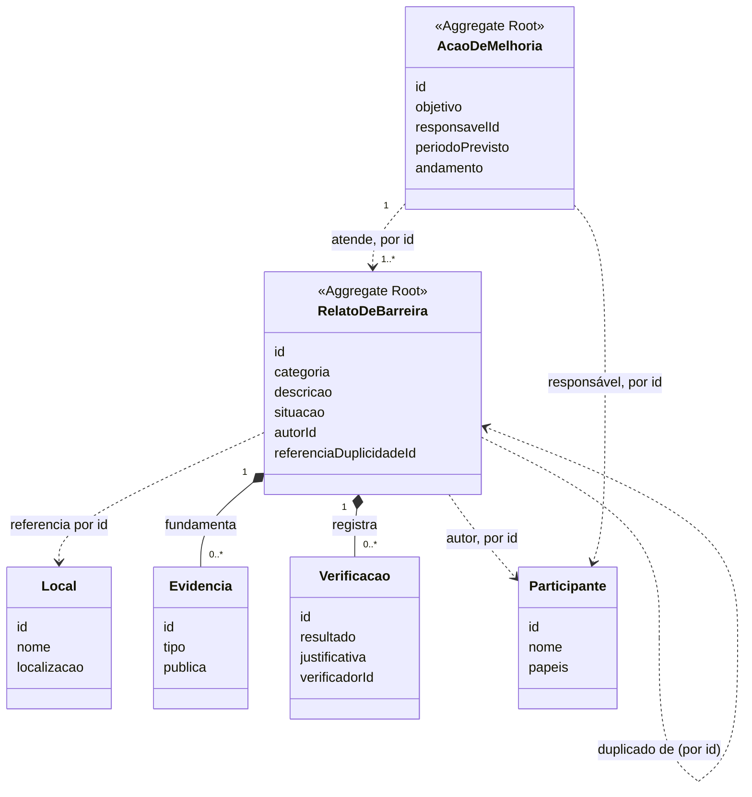

# Diagrama de domínio

> Rascunho inicial em Mermaid para o grupo ajustar. O GitHub renderiza este bloco automaticamente.

## Legenda
- Linha cheia com losango: pertence ao limite do agregado
- Linha pontilhada: apenas referência por identificador

## Decisões a registrar
- [PREENCHER: por que Ação de Melhoria é (ou não) um agregado próprio]
- [PREENCHER: o que decidimos deixar fora do agregado Relato]
