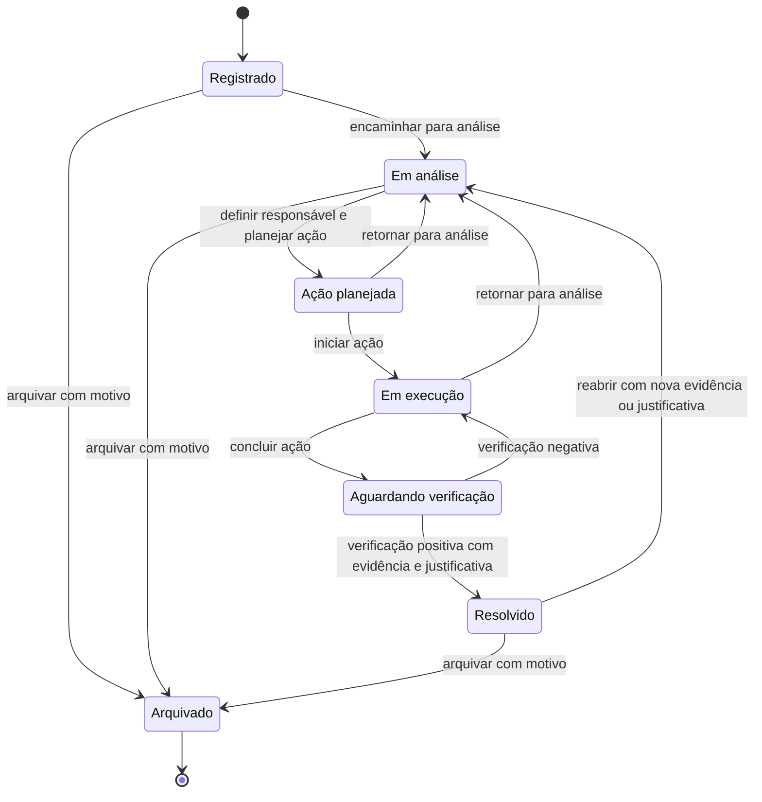

# Transição de situações do Relato de Barreira

> Rascunho baseado no fluxo sugerido no enunciado, com retornos, reabertura e arquivamento. O grupo deve revisar cada transição.

## Tabela de transições
| De | Para | Quem pode | Exige | Regra |
|---|---|---|---|---|
| Registrado | Em análise | [PREENCHER] | [PREENCHER] | [PREENCHER] |
| Em análise | Ação planejada | [PREENCHER] | Responsável definido | RN-04 |
| Ação planejada | Em execução | [PREENCHER] | Objetivo e responsável | RN-04 |
| Em execução | Aguardando verificação | [PREENCHER] | Conclusão da ação | RN-06 |
| Aguardando verificação | Resolvido | Verificador diferente de quem concluiu | Evidência e justificativa | RN-07, RN-08 |
| Resolvido | Em análise (reabertura) | [PREENCHER] | Nova evidência ou justificativa | RN-09 |
| Qualquer | Arquivado | [PREENCHER] | Motivo | RN-10 |

## Duplicidades
Relatos duplicados mantêm o registro original e apontam para o relato de referência. Evitar ciclos entre referências: [PREENCHER: como o grupo vai garantir isso].
